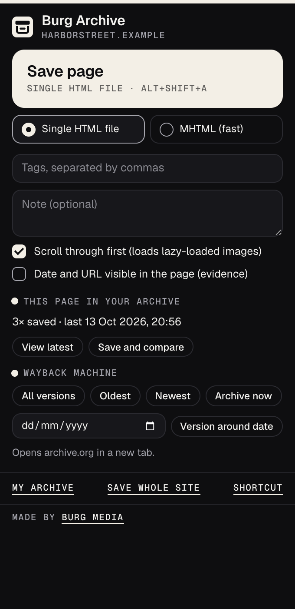
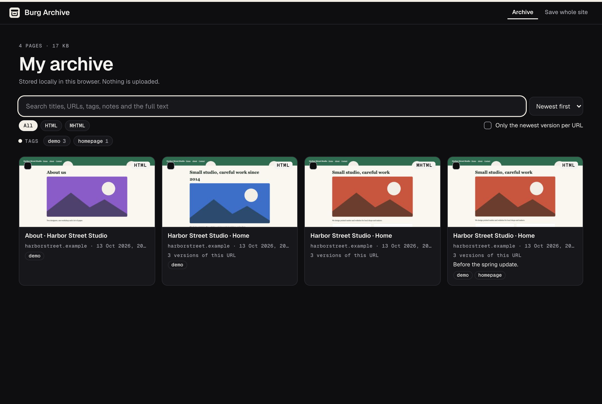
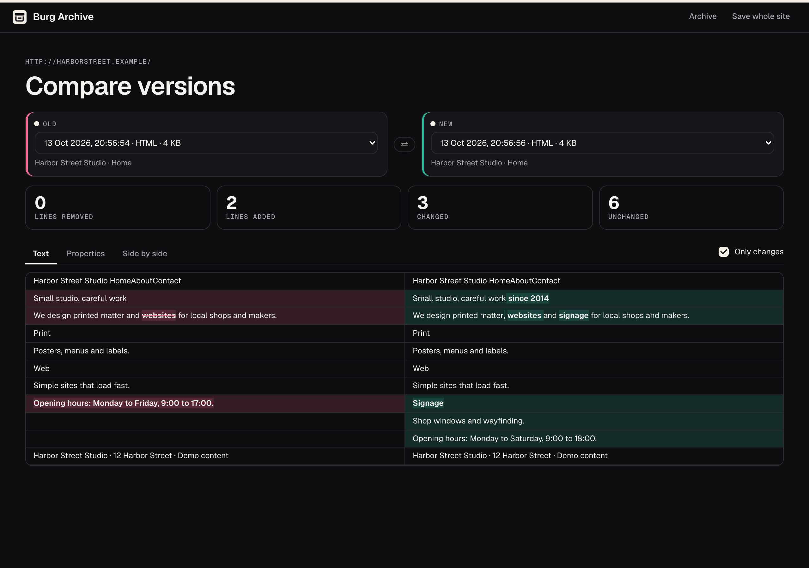

# Burg Archive

A Chrome extension to save web pages as they look right now, as one self-contained HTML file or as MHTML, keep them in a searchable archive in your browser, compare versions and look up older versions on the Wayback Machine.





## Features

- **Save a page as one HTML file.** Images, stylesheets and fonts are embedded as data URIs, scripts are removed. The file opens in any browser, also offline. The page is frozen as you see it: typed form values (except password and file fields), open `<details>`, canvas drawings (as images), shadow DOM and CSS added by JavaScript. Frames, also from other domains, are embedded in their parent.
- **Or as MHTML.** Faster, made by Chrome itself in one step. MHTML opens in Chrome and Edge, but cannot be previewed inside the extension.
- **Lazy-loaded images.** Optionally scrolls through the page first so images that only load on scroll are saved too, then restores your scroll position.
- **Three ways to save.** The toolbar popup, the keyboard shortcut Alt+Shift+A (change it under `chrome://extensions/shortcuts`) or "Save page to Burg Archive" in the right-click menu. The toolbar icon shows the progress, then a check mark or an error.
- **Evidence.** Every saved file gets a SHA-256 fingerprint in its details. Optionally a black bar with the date, time and URL is added to the top of the saved page.
- **My archive.** Thumbnails, tags and notes, and search in titles, URLs, tags, notes and the full visible text of every saved page. Filter by type, tag or site run, show only the newest version per URL, sort by date, title, site or size.
- **Bulk actions.** Select pages to download them as one ZIP, add tags, delete them or compare exactly two.
- **Compare versions.** The same URL saved at two moments: the text difference with changed words marked, the page properties (title, description, canonical, robots, H1, H2, word, link and image counts) side by side, and both saved pages next to each other.
- **Save a whole site.** Finds the pages of a site through `robots.txt` and its sitemap(s), or by following links up to a chosen depth (1 to 5 clicks, at most 1000 pages). The pages open one by one in a separate window and are saved. The ZIP has a folder per site, an `OVERVIEW.html`, an `archief.json` with URLs, dates and fingerprints, and links between saved pages are rewritten to relative paths so they keep working.
- **Wayback Machine buttons.** Open all versions of the current page on web.archive.org, the oldest, the newest, a version around a date you choose, or ask the Wayback Machine to archive the page now.
- **English and Dutch** interface, following your browser language.



## Install from source (Developer mode)

The easiest way to install Burg Archive is the Chrome Web Store version, linked from the [Burg Archive page](https://burgmedia.eu/shop/burg-archief). That version updates automatically. If you prefer to run the code from this repository, it takes a minute:

1. **Download the code.** Click the green **Code** button on this page and choose **Download ZIP**, or download the zip from [Releases](../../releases). Unzip it.
2. **Open the extensions page.** Type `chrome://extensions` in the address bar and press Enter.
3. **Turn on Developer mode.** Use the **Developer mode** switch in the top right corner.
4. **Load the extension.** Click **Load unpacked** and choose the unzipped folder (the folder that contains `manifest.json`).
5. **Pin it.** Click the puzzle piece icon in the toolbar and pin Burg Archive, so the icon is always visible.

Good to know:

- **Other browsers.** This also works in other Chromium based browsers, such as Microsoft Edge (`edge://extensions`), Brave (`brave://extensions`) and Opera (`opera://extensions`). The steps are the same; the Developer mode switch may be in a different place on the page. Burg Archive needs version 120 or newer.
- **No automatic updates.** An extension loaded this way does not update itself. To update, download the new version, replace the folder and click the **Reload** icon on the Burg Archive card in `chrome://extensions`. Your archive is kept when you reload, but removing the extension deletes it.
- **Developer mode notice.** Chrome may remind you that extensions in developer mode are running. That is normal for extensions you load yourself.

## Check it yourself with your AI agent

The code is small, has no build step and is not minified, so you don't have to take our word for anything. Point your own AI agent (Claude Code, Cursor, Copilot, ChatGPT) at this folder and let it check.

```text
Audit this Chrome extension for security and privacy before I install it.
1. List every permission in manifest.json and whether the code actually needs it.
2. Find every network request (fetch, XMLHttpRequest, WebSocket, sendBeacon, image or
   script URLs, remote code) and tell me where data goes.
3. Check for remote code execution: eval, new Function, remotely loaded scripts.
4. Check what is stored (chrome.storage, IndexedDB, cookies) and whether anything
   leaves my browser.
5. Check content scripts: which sites they run on and what they read from pages.
6. Give a verdict: safe to install or not, with file and line references.
```

The fastest manual check, from inside the folder:

```sh
grep -rn "fetch\|XMLHttpRequest\|http" .
```

Besides this README you will find the burgmedia.eu links described below, the web.archive.org link templates in `lib/util.js`, the `fetch()` in `lib/capture.js` that downloads the images, stylesheets and fonts of a page you save, the `fetch()` in `site/site.js` that reads `robots.txt`, sitemaps and pages when you save a whole site, one `fetch()` that decodes the thumbnail screenshot (a `data:` URL, no network), example URLs in the placeholder texts, and XML namespace strings.

## Privacy and security

- **No account, no analytics, no tracking, no ads.**
- **No remote code.** All JavaScript is in this repository. There are no CDNs or external scripts, and the extension pages only allow scripts from the extension itself (`script-src 'self'` in `manifest.json`). The fonts (Geist and Geist Mono) are included in `fonts/`.
- **Your archive stays in your browser.** Saved pages are stored in IndexedDB (database `burg-archief`) on your device: the file (HTML or MHTML), its visible text for search and compare, and its details (URL, title, date, size, SHA-256, tags, note, a small JPEG thumbnail and page properties). Your three settings (format, scroll first, stamp) are in `chrome.storage.local`. Nothing is synced or uploaded. Delete pages in the archive at any time; removing the extension removes everything.
- **Pages are read only when you save.** There are no content scripts in `manifest.json`. The freeze script (`content/freeze.js`) is injected only into the page you save, after you click save, press the shortcut, use the right-click menu or start a whole-site run.
- **Saved pages contain what you saw.** If you are logged in, the saved file contains that logged-in view. Typed form values are kept, except password and file fields, which are emptied. Hidden form fields keep their value.
- **Saved pages cannot run code.** Scripts, `on…` attributes and `javascript:` links are removed, and the file gets a Content Security Policy that blocks scripts. Inside the extension a saved page is shown in a sandboxed frame without script permission.
- **Downloads are made locally.** HTML, MHTML and ZIP files are built in your browser and saved through a normal download.

What does go out, and when:

- **When you save a page (single HTML file)**, the extension downloads that page's images, stylesheets and fonts from the servers they come from, with your cookies for those sites, just like the browser does when it shows the page (often straight from the browser cache). For MHTML, Chrome builds the file from the page it already loaded. No archive data, tags or notes are sent anywhere.
- **When you save a whole site**, the extension requests `robots.txt` and up to 50 sitemap files from the site you entered, or, when following links, fetches pages of that site to find their links (again with your cookies). It then opens each chosen page in a separate window, which is a normal visit: those pages load their own scripts, analytics and ads as usual, and the site sees a visit for each page.
- **Wayback Machine buttons, only when you click one.** Each button opens a new tab on `web.archive.org` with the URL of the current page (or of the saved page, on its detail page) in the address: `https://web.archive.org/web/*/<url>` (all versions), `/web/19960101000000/<url>` (oldest), `/web/<current time>/<url>` (newest), `/web/<chosen date>120000/<url>` (around a date) or `/save/<url>` (archive now). So archive.org receives that page URL, including any query string (a `#fragment` stays in your browser), plus the chosen date for "around a date" and what any website sees on a visit, such as your IP address, browser and archive.org's own cookies. **"Archive now"** asks the Wayback Machine to fetch that URL itself and make a **public** copy; don't use it for private pages or URLs with personal data in them. No page content, text, tags, notes or other parts of your archive are sent to archive.org. Nothing is sent to archive.org automatically.
- **Viewing a saved page** inside the extension can still load some things from the original site: videos and audio (these are not embedded), resources that failed to download or were larger than 25 MB, and frames whose content could not be read. Links in a saved page open the real site in a new tab when you click them.
- **After installing**, a welcome page opens once on burgmedia.eu (`https://burgmedia.eu/extensies/burg-archief/welkom/`). **After removing** the extension, Chrome opens a short page there (`…/verwijderd/`). Both URLs carry only fixed labels (`utm_source=burg-archief&utm_medium=extension&utm_campaign=install` or `uninstall`). No settings, URLs, identifiers or archive data are added. It is a normal page visit, so burgmedia.eu sees what any website sees, such as your IP address and browser; the privacy policy of burgmedia.eu applies there.
- **"Made by Burg Media"** at the bottom of the popup is a link with the same kind of labels (`utm_campaign=popup`). It opens only when you click it.

Found a security problem? See [SECURITY.md](SECURITY.md).

## Why is this free?

Burg Media is a small web studio in the Netherlands. We build these tools for our own work and give them away: no ads, no premium tier, no data collection. If they are useful to you, that is the best introduction to what we do. We build websites, web apps and custom software: [burgmedia.eu](https://burgmedia.eu)

## Permissions explained

| Permission | Why Burg Archive needs it |
|---|---|
| `<all_urls>` (host permission) | To save any regular web page: read the page and its frames (also from other domains), download its images, stylesheets and fonts (often from CDNs) to embed them, and take the thumbnail with `chrome.tabs.captureVisibleTab`. "Save whole site" also needs it to read `robots.txt` and sitemaps and to capture the pages it opens without a click per page, which `activeTab` does not allow. Nothing runs on a page until you save it. |
| `scripting` | Injects `content/freeze.js` (and the translation helper `lib/i18n.js`) into the page you save and its frames, to read the current page, and optionally scrolls through it first for lazy-loaded images. Only when you save, and only code from this repository. |
| `pageCapture` | For the MHTML option: `chrome.pageCapture.saveAsMHTML` creates the MHTML file of the page you save. |
| `tabs` | Reads the URL and title of the current tab (the popup shows if you saved this page before, and the URL is stored with the saved page). For "Save whole site" it opens the pages one by one in a separate window and waits until each has loaded. Also used to open the archive, compare and Wayback Machine pages in new tabs. |
| `contextMenus` | Adds "Save page to Burg Archive" to the right-click menu on http and https pages, and "Open my archive" and "Save whole site…" to the menu of the toolbar icon. |
| `storage` | Saves your three settings (format, scroll first, stamp) locally in `chrome.storage.local`. |
| `unlimitedStorage` | Saved pages with embedded images and fonts are often several megabytes, so an archive of hundreds of pages does not fit in the default storage quota. Everything stays on your device. |

There are no content scripts in `manifest.json`: the freeze script is injected only when you save. The `commands` entry in the manifest is the keyboard shortcut (Alt+Shift+A), not a permission. Opening a separate window for "Save whole site" uses `chrome.windows`, which needs no extra permission.

## Alternatives

Looking for an alternative to SingleFile, Save Page WE or the Wayback Machine extension? Burg Archive combines saving a page as one self-contained file with a searchable archive of everything you saved, side-by-side comparison of two versions of the same page, saving a whole site as a linked ZIP before a redesign or migration, and quick links to older versions on the Wayback Machine. Your archive stays in your browser, there is no account, and the source is right here for you to read.

## License

[MIT](LICENSE), Copyright (c) 2026 Burg Media. Third-party components and their licenses are listed in [NOTICE.md](NOTICE.md).

Made by [Burg Media](https://burgmedia.eu).
